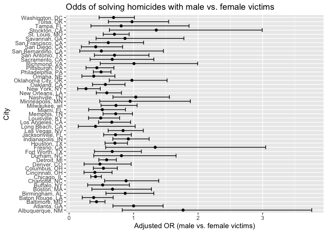
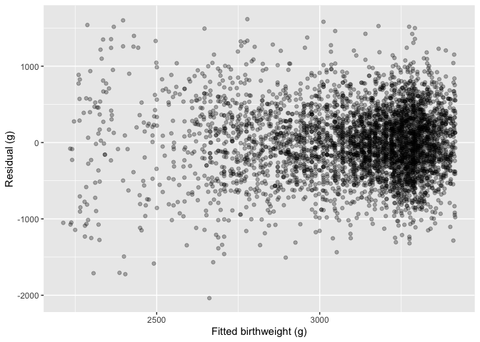
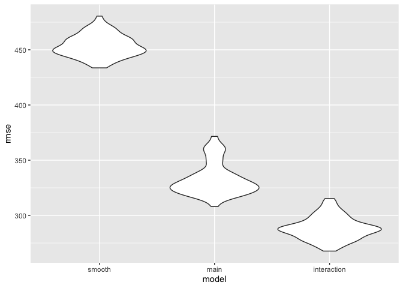

p8105_hw6_eej2124
================
Emma
2026-11-25

``` r
library(tidyverse)
```

    ## ── Attaching core tidyverse packages ──────────────────────── tidyverse 2.0.0 ──
    ## ✔ dplyr     1.2.1     ✔ readr     2.2.0
    ## ✔ forcats   1.0.1     ✔ stringr   1.6.0
    ## ✔ ggplot2   4.0.3     ✔ tibble    3.3.1
    ## ✔ lubridate 1.9.5     ✔ tidyr     1.3.2
    ## ✔ purrr     1.2.2     
    ## ── Conflicts ────────────────────────────────────────── tidyverse_conflicts() ──
    ## ✖ dplyr::filter() masks stats::filter()
    ## ✖ dplyr::lag()    masks stats::lag()
    ## ℹ Use the conflicted package (<http://conflicted.r-lib.org/>) to force all conflicts to become errors

``` r
library(modelr)
library(mgcv)
```

    ## Loading required package: nlme
    ## 
    ## Attaching package: 'nlme'
    ## 
    ## The following object is masked from 'package:dplyr':
    ## 
    ##     collapse
    ## 
    ## This is mgcv 1.9-4. For overview type '?mgcv'.

# Problem 1

## Importing and tidying the data

``` r
homicide_df = 
  read_csv("data/homicide-data.csv") |> 
  janitor::clean_names() |> 
   mutate(
    city_state = paste(city, state, sep = ", "), 
    solved = as.numeric(disposition == "Closed by arrest"), 
    victim_age = as.numeric(victim_age)
  ) |> 
  filter(city_state != "Dallas, TX", 
         city_state != "Phoenix, AZ",
         city_state != "Kansas City, MO", 
         city_state != "Tulsa, AL", 
         victim_race == "White" | victim_race == "Black"
         )  
```

    ## Rows: 52179 Columns: 12
    ## ── Column specification ────────────────────────────────────────────────────────
    ## Delimiter: ","
    ## chr (9): uid, victim_last, victim_first, victim_race, victim_age, victim_sex...
    ## dbl (3): reported_date, lat, lon
    ## 
    ## ℹ Use `spec()` to retrieve the full column specification for this data.
    ## ℹ Specify the column types or set `show_col_types = FALSE` to quiet this message.

    ## Warning: There was 1 warning in `mutate()`.
    ## ℹ In argument: `victim_age = as.numeric(victim_age)`.
    ## Caused by warning:
    ## ! NAs introduced by coercion

## Writing a glm function

``` r
city_glm = function(obs_city) {
  
  homicide_df |> 
    filter(city_state == obs_city) |> 
    glm(solved ~ victim_age + victim_sex + victim_race, data = _, family = binomial()) |> 
    broom::tidy(conf.int = TRUE) |> 
    filter(term == "victim_sexMale") |> 
    mutate(
      OR = exp(estimate), 
      ci_l = exp(conf.low), 
      ci_h = exp(conf.high)
      ) |> 
    select(term, OR, ci_l, ci_h)

}
```

``` r
city_glm("Baltimore, MD") |> 
  knitr::kable(digits = 3)
```

| term           |    OR |  ci_l |  ci_h |
|:---------------|------:|------:|------:|
| victim_sexMale | 0.426 | 0.324 | 0.558 |

## Mapping across every city in the dataset

``` r
results_df = 
  homicide_df |> 
  distinct(city_state) |> 
  mutate(results = map(city_state, city_glm)) |> 
  unnest(results)
```

    ## Warning: There were 43 warnings in `mutate()`.
    ## The first warning was:
    ## ℹ In argument: `results = map(city_state, city_glm)`.
    ## Caused by warning:
    ## ! glm.fit: fitted probabilities numerically 0 or 1 occurred
    ## ℹ Run `dplyr::last_dplyr_warnings()` to see the 42 remaining warnings.

## Making a plot

``` r
results_df |> 
  mutate(fct_reorder(city_state, OR)) |> 
  ggplot(aes(x = city_state, y = OR)) +
  geom_point() +
  geom_errorbar(aes(ymin = ci_l, ymax = ci_h)) +
  coord_flip() +
  labs(
    x = "City",
    y = "Adjusted OR (male vs. female victims)",
    title = "Odds of solving homicides with male vs. female victims"
  ) 
```

<!-- -->

Cities with odds ratios of more than 1 mean that homicides with male
victims are more likely to be solved. Cities with odds ratios of less
than 1 mean that homicides with female victims are more likely to be
solved. In most cities, homicides with female victims are more likely to
be solved because the odds ratio is less than 1. Interestingly, cities
with odds ratios higher than 1 often have larger confidence intervals.

# Problem 2

## Importing data

``` r
library(p8105.datasets)
data("weather_df")
```

``` r
weather_df |> 
  lm(tmax ~ tmin + prcp, data = _)
```

    ## 
    ## Call:
    ## lm(formula = tmax ~ tmin + prcp, data = weather_df)
    ## 
    ## Coefficients:
    ## (Intercept)         tmin         prcp  
    ##    7.775638     1.017480    -0.005578

``` r
draw_boot_sample = function(df) {
  
  sample_frac(df, replace = TRUE)
  
}
```

``` r
boot_strap_df = 
  tibble(
    strap_number = 1:5000
  ) |> 
  mutate(
    strap_sample = map(strap_number, \(i) draw_boot_sample (weather_df))
  ) 
```

FIx this

# Problem 3

## Importing data

``` r
birthweight_df = 
  read_csv("data/birthweight.csv") |> 
  janitor::clean_names() |> 
  mutate( 
    babysex = case_match(
      babysex, 
      1 ~ "male", 
      2 ~ "female"
      ), 
    frace = case_match(
      frace, 
      1 ~ "White", 
      2 ~ "Black", 
      3 ~ "Asian", 
      4 ~ "Puerto Rican", 
      8 ~ "Other", 
      9 ~ "Unknown"
    ), 
    malform = case_match(
      malform, 
      0 ~ "absent",
      1 ~ "present"
    ), 
    mrace = case_match(
      mrace, 
      1 ~ "White",
      2 ~ "Black", 
      3 ~ "Asian", 
      4 ~ "Puerto Rican", 
      8 ~ "Other"
    )
    )
```

    ## Rows: 4342 Columns: 20
    ## ── Column specification ────────────────────────────────────────────────────────
    ## Delimiter: ","
    ## dbl (20): babysex, bhead, blength, bwt, delwt, fincome, frace, gaweeks, malf...
    ## 
    ## ℹ Use `spec()` to retrieve the full column specification for this data.
    ## ℹ Specify the column types or set `show_col_types = FALSE` to quiet this message.

    ## Warning: There was 1 warning in `mutate()`.
    ## ℹ In argument: `babysex = case_match(babysex, 1 ~ "male", 2 ~ "female")`.
    ## Caused by warning:
    ## ! `case_match()` was deprecated in dplyr 1.2.0.
    ## ℹ Please use `recode_values()` instead.

## Making a model for birthweight

``` r
smooth_mod = gam(bwt ~ s(fincome) + s(gaweeks), data = birthweight_df)
```

I was interested in using family monthly income and gestational age as
predictors of birthweight. I used a smooth fit to model this
relationship.

``` r
birthweight_df |> 
  add_predictions(smooth_mod) |> 
  add_residuals(smooth_mod) |> 
  ggplot(aes(x = pred, y = resid)) +
  geom_point(alpha = 0.3) +
  labs(x = "Fitted birthweight (g)", y = "Residual (g)")
```

<!-- -->

## Other models

``` r
main_effect_mod = lm(bwt ~ blength + gaweeks, data = birthweight_df)
interaction_mod = lm(bwt ~ bhead * blength * babysex, data = birthweight_df)
```

## Comparing with cross validation

``` r
cv_df = 
  crossv_mc(birthweight_df, 100) |> 
  mutate(
    train = map(train, as_tibble),
    test  = map(test, as_tibble)
  ) |> 
  mutate(
    smooth_fit = map(train, \(df) gam(bwt ~ babysex + s(fincome) + s(gaweeks), data = df)),
    main_effect_fit = map(train, \(df) lm(bwt ~ blength + gaweeks, data = df)),
    interaction_fit = map(train, \(df) lm(bwt ~ bhead * blength * babysex, data = df))
  ) |> 
  mutate(
    rmse_smooth = map2_dbl(smooth_fit, test, rmse),
    rmse_main = map2_dbl(main_effect_fit, test, rmse),
    rmse_interaction = map2_dbl(interaction_fit, test, rmse)
  )
```

``` r
cv_df |> 
  select(starts_with("rmse")) |> 
  pivot_longer(
    everything(),
    names_to = "model", 
    values_to = "rmse",
    names_prefix = "rmse_") |> 
  mutate(model = fct_inorder(model)) |> 
  ggplot(aes(x = model, y = rmse)) + geom_violin()
```

<!-- -->

My hypothetical model is terrible. It does not compare with the other
two models. The interaction model is by far the best of the three.
